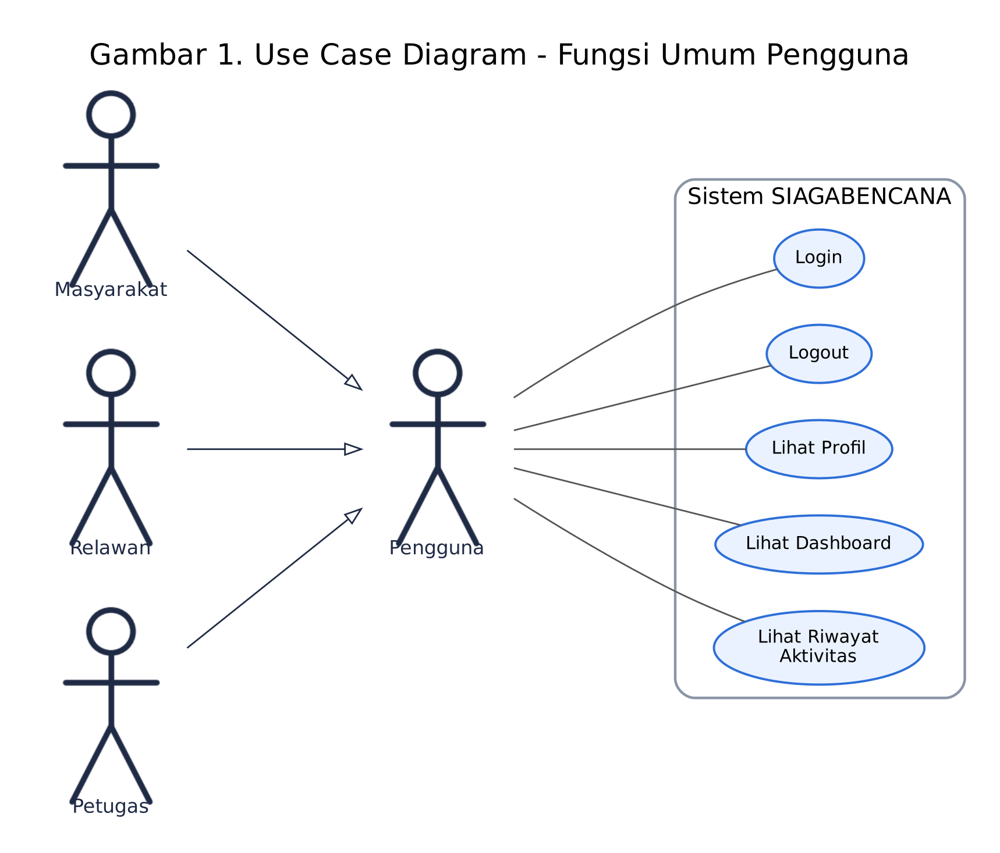
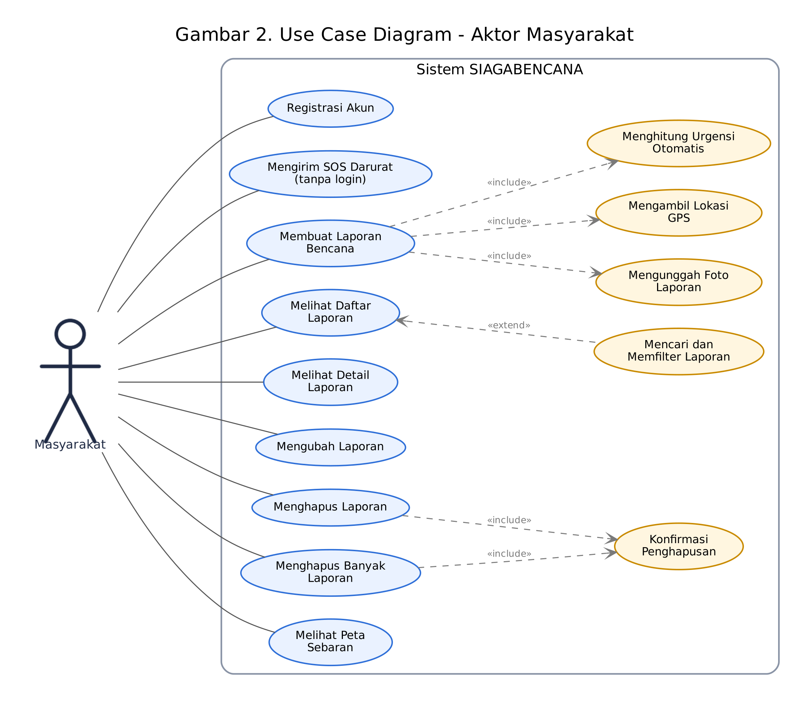
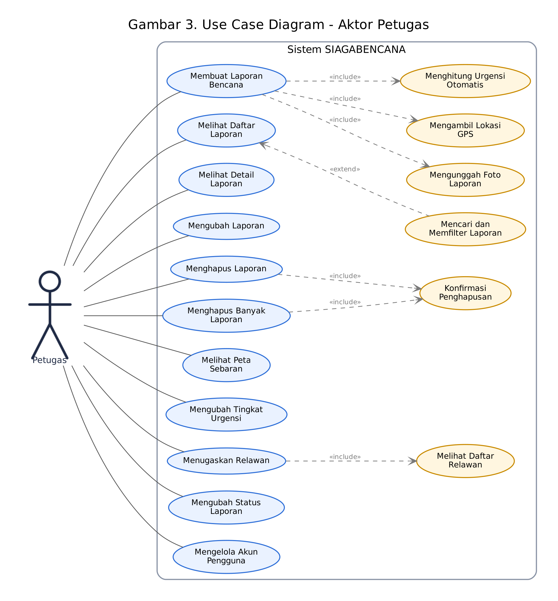
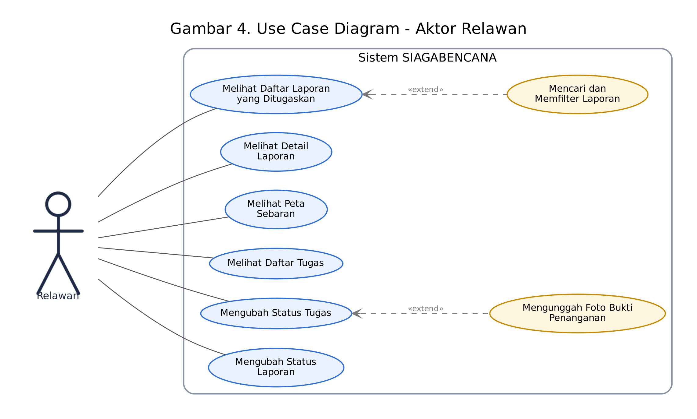

# Use Case SIAGABENCANA

Sistem Pelaporan dan Koordinasi Penanganan Bencana Lingkungan Berbasis Android.
Dokumen ini siap dipakai untuk bab **Analisis Kebutuhan / Use Case** di laporan. Gambar diagram ada di file `usecase_1_umum.png` sampai `usecase_4_relawan.png` (satu folder dengan dokumen ini).

---

## 1. Aktor

| Aktor | Deskripsi |
|---|---|
| **Pengguna** | Aktor abstrak: semua pengguna yang sudah login. Fungsi umumnya diwarisi oleh ketiga aktor di bawah. |
| **Masyarakat** | Warga yang melaporkan kejadian bencana dan memantau status laporannya. Dapat mengirim SOS darurat tanpa login. |
| **Relawan** | Pelaksana lapangan yang menerima penugasan, memperbarui status penanganan, dan mengunggah bukti. |
| **Petugas** | Pengelola penanganan bencana: memverifikasi laporan, mengatur urgensi, menugaskan relawan, dan mengelola akun. |

---

## 2. Daftar Use Case

| ID | Use Case | Aktor |
|---|---|---|
| UC-01 | Registrasi Akun | Masyarakat |
| UC-02 | Login | Pengguna |
| UC-03 | Logout | Pengguna |
| UC-04 | Lihat Profil | Pengguna |
| UC-05 | Lihat Dashboard | Pengguna |
| UC-06 | Lihat Riwayat Aktivitas | Pengguna |
| UC-07 | Membuat Laporan Bencana | Masyarakat, Petugas |
| UC-08 | Mengirim SOS Darurat | Masyarakat (tanpa login) |
| UC-09 | Melihat Daftar Laporan | Masyarakat, Relawan, Petugas |
| UC-10 | Melihat Detail Laporan | Masyarakat, Relawan, Petugas |
| UC-11 | Mengubah Laporan | Masyarakat, Petugas |
| UC-12 | Menghapus Laporan | Masyarakat, Petugas |
| UC-13 | Menghapus Banyak Laporan | Masyarakat, Petugas |
| UC-14 | Melihat Peta Sebaran | Masyarakat, Relawan, Petugas |
| UC-15 | Mengubah Tingkat Urgensi | Petugas |
| UC-16 | Menugaskan Relawan | Petugas |
| UC-17 | Mengubah Status Laporan | Petugas, Relawan |
| UC-18 | Mengelola Akun Pengguna | Petugas |
| UC-19 | Melihat Daftar Tugas | Relawan |
| UC-20 | Mengubah Status Tugas | Relawan |
| UC-21 | Mengunggah Foto Bukti Penanganan | Relawan |

**Use case pendukung** (relasi `include` / `extend`):

| ID | Use Case Pendukung | Relasi |
|---|---|---|
| UC-07a | Mengunggah Foto Laporan | `include` dari UC-07 |
| UC-07b | Mengambil Lokasi GPS | `include` dari UC-07 |
| UC-07c | Menghitung Urgensi Otomatis | `include` dari UC-07 |
| UC-09a | Mencari dan Memfilter Laporan | `extend` ke UC-09 |
| UC-12a | Konfirmasi Penghapusan | `include` dari UC-12 dan UC-13 |
| UC-16a | Melihat Daftar Relawan | `include` dari UC-16 |
| UC-21 | Mengunggah Foto Bukti Penanganan | `extend` ke UC-20 |

---

## 3. Diagram Use Case

### Gambar 1. Fungsi Umum Pengguna

### Gambar 2. Aktor Masyarakat

### Gambar 3. Aktor Petugas

### Gambar 4. Aktor Relawan

---

## 4. Deskripsi Use Case

### 4.1 Fungsi Umum

**UC-01 Registrasi Akun**

| | |
|---|---|
| Aktor | Masyarakat |
| Deskripsi | Calon pengguna membuat akun baru. Akun yang dibuat selalu berperan sebagai masyarakat. |
| Prasyarat | Aplikasi terhubung ke server. |
| Alur utama | 1) Aktor membuka halaman registrasi. 2) Aktor mengisi nama, email, kata sandi, konfirmasi kata sandi, dan nomor HP (opsional). 3) Aktor menekan tombol Daftar. 4) Sistem memvalidasi data dan menyimpan akun. 5) Sistem masuk ke aplikasi dan menampilkan dashboard. |
| Alur alternatif | 4a) Email sudah terdaftar atau data tidak valid: sistem menampilkan pesan kesalahan di kolom terkait. |
| Hasil | Akun masyarakat baru terbuat dan pengguna sudah login. |

**UC-02 Login**

| | |
|---|---|
| Aktor | Pengguna (Masyarakat, Relawan, Petugas) |
| Deskripsi | Pengguna masuk ke aplikasi dengan akun yang sudah ada. |
| Prasyarat | Pengguna memiliki akun. |
| Alur utama | 1) Aktor mengisi email dan kata sandi. 2) Aktor menekan tombol Login. 3) Sistem memverifikasi akun dan membuat token akses. 4) Sistem menampilkan dashboard sesuai peran. |
| Alur alternatif | 3a) Email atau kata sandi salah: sistem menampilkan pesan "Email atau password salah". 3b) Terlalu banyak percobaan: sistem membatasi sementara. |
| Hasil | Sesi login tersimpan; menu yang tampil sesuai peran pengguna. |

**UC-03 Logout**

| | |
|---|---|
| Aktor | Pengguna |
| Prasyarat | Pengguna sudah login. |
| Alur utama | 1) Aktor memilih Logout. 2) Sistem menghapus token akses dan sesi di perangkat. 3) Sistem kembali ke halaman login. |
| Hasil | Sesi berakhir; token tidak dapat dipakai lagi. |

**UC-04 Lihat Profil**

| | |
|---|---|
| Aktor | Pengguna |
| Prasyarat | Pengguna sudah login. |
| Alur utama | 1) Aktor membuka menu Profil. 2) Sistem menampilkan nama, email, peran, dan nomor HP. |
| Hasil | Data akun pengguna tampil. |

**UC-05 Lihat Dashboard**

| | |
|---|---|
| Aktor | Pengguna |
| Deskripsi | Menampilkan ringkasan statistik sesuai peran. |
| Prasyarat | Pengguna sudah login. |
| Alur utama | 1) Aktor membuka Dashboard. 2) Sistem mengambil ringkasan: total laporan, jumlah per status, per urgensi, per kategori, dan laporan terbaru. 3) Sistem menampilkan data. Masyarakat melihat data laporannya sendiri, relawan melihat tugasnya, petugas melihat seluruh data. |
| Alur alternatif | 2a) Gagal terhubung: sistem menampilkan pesan kesalahan dan tombol "Coba lagi". 2b) Belum ada data: sistem menampilkan tampilan data kosong. |
| Hasil | Statistik ringkas tampil. |

**UC-06 Lihat Riwayat Aktivitas**

| | |
|---|---|
| Aktor | Pengguna |
| Deskripsi | Menampilkan catatan perubahan status laporan (siapa, kapan, dari status apa ke status apa). |
| Prasyarat | Pengguna sudah login. |
| Alur utama | 1) Aktor membuka menu Riwayat. 2) Sistem menampilkan daftar perubahan dengan yang terbaru di atas. 3) (Opsional) Aktor memilih satu laporan untuk melihat riwayatnya saja. |
| Alur alternatif | 2a) Belum ada riwayat: tampil data kosong. |
| Hasil | Riwayat aktivitas tampil sesuai hak akses peran. |

### 4.2 Pelaporan Bencana

**UC-07 Membuat Laporan Bencana**

| | |
|---|---|
| Aktor | Masyarakat, Petugas |
| Deskripsi | Pengguna melaporkan kejadian bencana lingkungan beserta foto dan lokasinya. |
| Prasyarat | Pengguna sudah login. |
| Alur utama | 1) Aktor membuka form laporan baru. 2) Aktor mengisi judul, kategori, deskripsi, dan jumlah terdampak. 3) Aktor mengunggah foto (UC-07a). 4) Aktor mengambil lokasi dari GPS atau menggeser pin di peta (UC-07b). 5) Aktor menekan Kirim. 6) Sistem memvalidasi data dan menghitung tingkat urgensi otomatis (UC-07c). 7) Sistem menyimpan laporan dengan status "baru" dan mencatat riwayat "Laporan dibuat". |
| Alur alternatif | 6a) Data wajib kosong atau tidak valid (misalnya foto lebih dari 4 MB): sistem menampilkan pesan di kolom terkait. 4a) Izin lokasi ditolak: aktor memilih lokasi manual di peta. |
| Hasil | Laporan tersimpan dan muncul di daftar laporan. |

**UC-08 Mengirim SOS Darurat**

| | |
|---|---|
| Aktor | Masyarakat (tidak harus login) |
| Deskripsi | Pengiriman sinyal darurat cepat dengan lokasi GPS. |
| Prasyarat | Perangkat dapat menentukan lokasi. |
| Alur utama | 1) Aktor menekan tombol SOS. 2) Aktor (opsional) mengisi nama, nomor HP, dan keterangan singkat. 3) Sistem mengirim koordinat lokasi. 4) Sistem membuat laporan darurat berurgensi kritis dengan status "baru" dan mencatat riwayat "Sinyal Darurat SOS Dipicu". 5) Sistem menampilkan konfirmasi bahwa sinyal terkirim. |
| Alur alternatif | 3a) Pengiriman terlalu sering: sistem membatasi (maksimal 5 kali per menit). |
| Hasil | Laporan darurat muncul di daftar laporan petugas. |

**UC-09 Melihat Daftar Laporan**

| | |
|---|---|
| Aktor | Masyarakat, Relawan, Petugas |
| Deskripsi | Menampilkan daftar laporan secara berhalaman. Masyarakat hanya melihat laporannya sendiri, relawan hanya yang ditugaskan padanya, petugas melihat semuanya. |
| Prasyarat | Pengguna sudah login. |
| Alur utama | 1) Aktor membuka menu Laporan. 2) Sistem menampilkan indikator loading lalu daftar laporan (judul, kategori, urgensi, status, tanggal). |
| Alur alternatif | 2a) Tidak ada laporan: tampil tampilan data kosong. 2b) Jaringan gagal: tampil pesan kesalahan dan tombol "Coba lagi". *Ekstensi UC-09a:* aktor mengetik kata kunci atau memilih filter (status, urgensi, kategori), lalu daftar diperbarui. |
| Hasil | Daftar laporan tampil sesuai hak akses. |

**UC-10 Melihat Detail Laporan**

| | |
|---|---|
| Aktor | Masyarakat, Relawan, Petugas |
| Prasyarat | Pengguna sudah login dan berhak melihat laporan tersebut. |
| Alur utama | 1) Aktor memilih satu laporan dari daftar. 2) Sistem menampilkan foto, deskripsi, lokasi, urgensi, status, data penugasan, dan riwayat status laporan. |
| Alur alternatif | 2a) Laporan tidak ditemukan atau bukan hak aktor: sistem menampilkan pesan yang sesuai. |
| Hasil | Informasi lengkap satu laporan tampil. |

**UC-11 Mengubah Laporan**

| | |
|---|---|
| Aktor | Masyarakat (laporan milik sendiri), Petugas (semua laporan) |
| Prasyarat | Pengguna sudah login. Untuk masyarakat, laporan masih berstatus "baru". |
| Alur utama | 1) Aktor membuka detail laporan dan memilih Ubah. 2) Aktor mengedit data atau mengganti foto. 3) Aktor menekan Simpan. 4) Sistem memvalidasi dan memperbarui laporan. |
| Alur alternatif | 4a) Laporan milik masyarakat sudah diproses: sistem menolak dengan pesan "Laporan sudah diproses dan tidak dapat diubah". 4b) Data tidak valid: sistem menampilkan pesan di kolom terkait. |
| Hasil | Data laporan diperbarui. |

**UC-12 Menghapus Laporan**

| | |
|---|---|
| Aktor | Masyarakat (milik sendiri, status "baru"), Petugas (semua laporan) |
| Prasyarat | Pengguna sudah login dan berhak menghapus. |
| Alur utama | 1) Aktor memilih Hapus pada sebuah laporan. 2) Sistem menampilkan dialog konfirmasi (UC-12a). 3) Aktor memilih Ya. 4) Sistem menghapus laporan. |
| Alur alternatif | 3a) Aktor memilih Batal: tidak ada yang dihapus. 4a) Tidak berhak: sistem menolak dengan pesan akses ditolak. |
| Hasil | Laporan terhapus dari daftar. |

**UC-13 Menghapus Banyak Laporan**

| | |
|---|---|
| Aktor | Masyarakat, Petugas |
| Prasyarat | Pengguna sudah login. |
| Alur utama | 1) Aktor menahan lama satu item untuk masuk ke mode pilih. 2) Aktor mencentang beberapa laporan. 3) Aktor menekan tombol Hapus. 4) Sistem menampilkan dialog konfirmasi (UC-12a). 5) Aktor memilih Ya. 6) Sistem menghapus laporan yang diizinkan dalam satu transaksi dan melaporkan jumlah yang terhapus. |
| Alur alternatif | 6a) Sebagian laporan tidak boleh dihapus (bukan milik aktor atau sudah diproses): laporan itu dilewati dan ditampilkan sebagai tidak terhapus. |
| Hasil | Laporan yang diizinkan terhapus sekaligus. |

**UC-14 Melihat Peta Sebaran**

| | |
|---|---|
| Aktor | Masyarakat, Relawan, Petugas |
| Deskripsi | Menampilkan titik lokasi laporan di peta dengan warna sesuai tingkat urgensi (hijau: rendah, kuning: sedang, oranye: tinggi, merah: kritis). |
| Prasyarat | Pengguna sudah login. |
| Alur utama | 1) Aktor membuka menu Peta. 2) Sistem menampilkan marker laporan sesuai hak akses. 3) Aktor mengetuk marker untuk melihat ringkasan dan membuka detail laporan. |
| Alur alternatif | 2a) Belum ada laporan: peta tampil tanpa marker disertai pesan data kosong. |
| Hasil | Sebaran lokasi bencana terlihat. |

### 4.3 Koordinasi Penanganan

**UC-15 Mengubah Tingkat Urgensi**

| | |
|---|---|
| Aktor | Petugas |
| Deskripsi | Petugas mengoreksi tingkat urgensi hasil perhitungan otomatis. |
| Prasyarat | Petugas sudah login. |
| Alur utama | 1) Petugas membuka detail laporan. 2) Petugas memilih urgensi baru (rendah, sedang, tinggi, kritis) dan menulis alasan (opsional). 3) Sistem menyimpan dan mencatat perubahan di riwayat. |
| Hasil | Urgensi laporan diperbarui. |

**UC-16 Menugaskan Relawan**

| | |
|---|---|
| Aktor | Petugas |
| Prasyarat | Petugas sudah login; ada laporan yang perlu ditangani; ada relawan terdaftar. |
| Alur utama | 1) Petugas membuka detail laporan dan memilih Tugaskan. 2) Sistem menampilkan daftar relawan beserta jumlah tugas aktifnya (UC-16a). 3) Petugas memilih relawan dan menulis catatan. 4) Sistem membuat penugasan berstatus "ditugaskan". 5) Jika status laporan masih "baru", sistem mengubahnya menjadi "diverifikasi" dan mencatat riwayat. |
| Alur alternatif | 4a) Pengguna yang dipilih bukan relawan: sistem menolak dengan pesan kesalahan. |
| Hasil | Relawan menerima penugasan di daftar tugasnya. |

**UC-17 Mengubah Status Laporan**

| | |
|---|---|
| Aktor | Petugas (semua status), Relawan (hanya laporan yang ditugaskan padanya, ke "ditangani" atau "selesai") |
| Deskripsi | Memperbarui tahap penanganan: baru, diverifikasi, ditangani, selesai. |
| Prasyarat | Pengguna sudah login dan berhak atas laporan tersebut. |
| Alur utama | 1) Aktor membuka detail laporan dan memilih Ubah Status. 2) Aktor memilih status baru dan menulis keterangan (opsional). 3) Sistem memperbarui status dan menambah satu baris riwayat (status lama, status baru, pengubah, waktu). |
| Alur alternatif | 3a) Relawan memilih status di luar kewenangannya: sistem menolak dengan pesan akses ditolak. |
| Hasil | Status laporan dan riwayat diperbarui. |

**UC-18 Mengelola Akun Pengguna**

| | |
|---|---|
| Aktor | Petugas |
| Deskripsi | Petugas membuat akun baru untuk relawan atau petugas lain. |
| Prasyarat | Petugas sudah login. |
| Alur utama | 1) Petugas membuka menu kelola akun. 2) Petugas mengisi nama, email, kata sandi, nomor HP, dan peran. 3) Sistem memvalidasi dan menyimpan akun baru. |
| Alur alternatif | 3a) Email sudah dipakai atau data tidak valid: sistem menampilkan pesan kesalahan. |
| Hasil | Akun dengan peran yang dipilih terbuat. |

### 4.4 Tugas Relawan

**UC-19 Melihat Daftar Tugas**

| | |
|---|---|
| Aktor | Relawan |
| Prasyarat | Relawan sudah login. |
| Alur utama | 1) Relawan membuka menu Tugas. 2) Sistem menampilkan penugasan milik relawan beserta judul laporan, urgensi, status tugas, dan catatan petugas. 3) (Opsional) Relawan memfilter berdasarkan status tugas. |
| Alur alternatif | 2a) Belum ada tugas: tampil tampilan data kosong. |
| Hasil | Relawan mengetahui tugas yang harus dikerjakan. |

**UC-20 Mengubah Status Tugas**

| | |
|---|---|
| Aktor | Relawan |
| Prasyarat | Relawan memiliki tugas. |
| Alur utama | 1) Relawan membuka detail tugas. 2) Relawan memilih "Terima" atau "Selesai". 3) Sistem memperbarui status tugas (ditugaskan, diterima, selesai). |
| Alur alternatif | *Ekstensi UC-21:* saat menyelesaikan tugas, relawan dapat mengunggah foto bukti. |
| Hasil | Status tugas diperbarui dan terlihat oleh petugas. |

**UC-21 Mengunggah Foto Bukti Penanganan**

| | |
|---|---|
| Aktor | Relawan |
| Prasyarat | Relawan memiliki tugas yang sedang berjalan. |
| Alur utama | 1) Relawan memilih Unggah Bukti pada tugasnya. 2) Relawan mengambil foto dari kamera atau memilih dari galeri, dan menulis catatan (opsional). 3) Sistem menyimpan foto (maksimal 4 MB, format gambar) dan menampilkannya di detail tugas. |
| Alur alternatif | 3a) File bukan gambar atau terlalu besar: sistem menolak dengan pesan kesalahan. |
| Hasil | Bukti penanganan tersimpan dan dapat dilihat petugas. |

---

## 5. Aturan Skor Urgensi Otomatis (UC-07c)

Dihitung saat laporan dibuat:

| Komponen | Skor |
|---|---|
| Bobot kategori (banjir 2, kebakaran 3, longsor 3, pencemaran 1, karhutla 3, lainnya 0) | 0 sampai 3 |
| Jumlah terdampak: 0-4 / 5-19 / 20-49 / 50 ke atas | 0 / 1 / 2 / 3 |
| Deskripsi memuat kata kunci (korban, terjebak, meluas, evakuasi, meninggal) | +2 |

Total skor: 0-2 rendah, 3-4 sedang, 5-6 tinggi, 7 ke atas kritis.

---

## Catatan untuk tim (bukan bagian laporan)

- **UC-08 (SOS) dan UC-18 (kelola akun)** adalah fitur tambahan buatan Anggota 2 yang belum ada di ERD dan kontrak API awal. Jika dimasukkan ke laporan, perbarui juga daftar endpoint.
- **Perilaku SOS saat ini:** laporan SOS ditempelkan ke akun masyarakat pertama di database dan kategori pertama (Banjir). Sebaiknya diganti ke kategori "Lainnya". Sesuaikan deskripsi UC-08 jika Anggota 2 mengubahnya.
- **Fitur belum jadi:** jika ada use case yang tidak sempat tersambung ke aplikasi sebelum deadline, tandai di laporan sebagai "pengembangan lanjutan" agar jujur dan konsisten dengan hasil implementasi.
